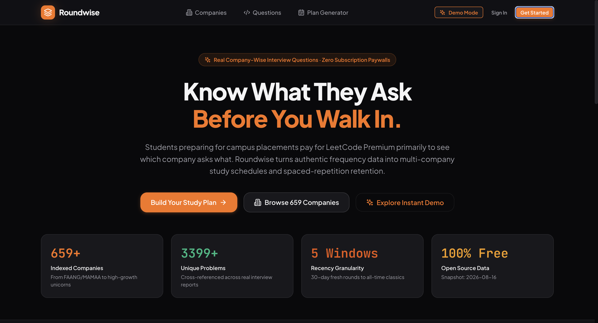

# Roundwise AI Interview Prep 🚀

**An AI-powered coding interview preparation platform with company-wise DSA questions, personalized revision scheduling, progress analytics, and AI-driven code analysis.**

<p align="center">
  <strong>Prepare smarter. Practice consistently. Track your progress.</strong>
</p>

---


## 🌐 Website Preview

[]([https://shopkart-fullstack-ecommerce.vercel.app/](https://roundwise-ai-interview-prep.onrender.com))


## 🌐 Live Demo
- **Demo Video:** [Add your demo video link]

---

## 📌 Overview

Roundwise AI Interview Prep is a coding interview preparation platform designed to help students and aspiring software engineers prepare for technical interviews in a structured and personalized way.

Preparing for coding interviews often involves switching between company-wise question lists, coding platforms, revision schedules, and code analysis tools. Roundwise brings these activities together in one platform.

Users can explore company-specific coding questions, generate personalized study plans, practice problems, analyze their code using AI, track their solving progress, and manage upcoming revisions.

The platform combines structured interview preparation with AI-assisted feedback to make practice more organized, efficient, and consistent.

## ✨ Key Features

### 1. 🏢 Company-Wise Question Directory

- Browse a directory of **659 companies**.
- Explore coding interview questions associated with different companies.
- View company-wise question counts.
- Search and filter the company directory.
- Sort companies by name and recency, where supported.
- Discover coding problems relevant to interview preparation.

### 2. 📅 Personalized Study Plan Generator

- Generate a study plan based on your preparation requirements.
- Organize coding practice into a structured workflow.
- Follow planned questions instead of choosing problems randomly.
- Use the generated plan to guide your interview preparation.

### 3. 🤖 AI-Powered Code Analysis

Analyze your coding solutions using AI to receive structured feedback, including supported analysis such as:

- Approach and logic explanation.
- Time and space complexity analysis.
- Identification of potential mistakes.
- Edge-case considerations.
- Suggestions for improving the solution.

The analysis depends on the submitted code and the AI service's response. AI-generated feedback should be reviewed and tested rather than treated as guaranteed correct.

### 4. 🔗 Coding Problem Practice

- Open coding problems on their linked problem-solving platforms.
- Work on a problem and return to Roundwise to analyze your solution.
- Connect problem practice with your study plan and progress tracking.

### 5. 📈 Progress Tracking

- Update the status of coding questions.
- Track your preparation progress.
- Keep your study activity organized.
- Review your progress as you work through interview questions.

### 6. 🔄 Revision Queue

- View questions that are due for review.
- See upcoming revisions.
- Revisit previously practiced problems.
- Build a more consistent revision routine.

### 7. 🔐 Authentication

- Register a user account.
- Log in and access the application.
- Use authenticated features according to the application's access controls.
- Try the application through Demo Mode, if available.

---

## 🛠️ Tech Stack

The project uses the following technologies. Check the final implementation and remove anything that is not actually used.

| Layer | Technology |
|---|---|
| Frontend | React |
| Frontend build tool | Vite |
| Styling | CSS / project styling framework |
| Backend | Node.js |
| API framework | Express.js |
| Database | MongoDB |
| Database integration | Mongoose, if used |
| AI integration | Google Gemini API |
| Authentication | As implemented in the project |
| Deployment | Render and/or the configured hosting provider |
| Version control | Git and GitHub |

---

## 🏗️ Application Architecture

Roundwise follows a client-server architecture.

1. **Frontend:** Provides the user interface for company discovery, study planning, coding practice, and progress tracking.
2. **Backend:** Handles API requests, application logic, authentication, database operations, and AI analysis.
3. **Database:** Stores persistent application data using MongoDB.
4. **AI Service:** Processes code-analysis requests through the configured Gemini API integration.
5. **External Coding Platforms:** Allow users to open and solve linked interview problems.

### High-Level Flow

```text
User
  |
  v
React + Vite Frontend
  |
  v
Node.js + Express Backend
  |
  +------> MongoDB Database
  |
  +------> Google Gemini API
  |
  +------> External Coding Platforms
```

---

## 📂 Project Structure

The repository is organized into frontend, backend, documentation, and configuration files.

```text
roundwise-ai-interview-prep/
├── .github/
├── .gitignore
├── .nvmrc
├── LICENSE
├── client/
│   └── Frontend application
├── docs/
│   └── Project documentation
├── server/
│   ├── data/
│   │   └── companies/
│   ├── tests/
│   └── Backend application
├── package.json
├── package-lock.json
├── render.yaml
└── README.md
```

*Note: This is a high-level structure. Add the exact internal folders and files from your final repository if you want to document them in detail.*

---

## ⚙️ Getting Started

Follow these steps to run the project locally.

### Prerequisites

Install the following before starting:

- Node.js — use a version compatible with the project's `.nvmrc`.
- npm.
- MongoDB Atlas account or another configured MongoDB instance.
- Google Gemini API key for AI analysis.
- Git.

### 1. Clone the Repository

```bash
git clone https://github.com/YOUR_USERNAME/roundwise-ai-interview-prep.git
cd roundwise-ai-interview-prep
```

Replace `YOUR_USERNAME` with your GitHub username.

### 2. Install Dependencies

Inspect the root `package.json` first to confirm whether it installs dependencies for both applications.

```bash
npm install
```

If the client and server have separate `package.json` files and dependencies are not installed by the root command, install them separately:

```bash
cd client
npm install

cd ../server
npm install
```

### 3. Configure Environment Variables

Create the required environment files for the frontend and backend.

**Backend — `server/.env`**

```env
PORT=5000
MONGODB_URI=your_mongodb_connection_string
GEMINI_API_KEY=your_gemini_api_key
```

**Frontend — `client/.env`**

```env
VITE_API_BASE_URL=http://localhost:5000
```

These names are examples. Use the exact variable names referenced by your final source code. If your application uses a different API URL variable or a different server port, configure those instead.

**Security notes:**
- Never commit `.env` files or API keys to GitHub.
- Keep `.env.example` files updated with placeholder values only.
- Configure production environment variables through your hosting provider's environment settings.
- Do not expose private backend API keys in frontend variables.

### 4. Start the Application

Run the frontend and backend using the scripts defined in your `package.json` files.

For example, if the backend has a `dev` script:

```bash
cd server
npm run dev
```

In a separate terminal, if the frontend has a `dev` script:

```bash
cd client
npm run dev
```

Open the local frontend URL printed by Vite in your terminal, commonly `http://localhost:5173`.

*Use the actual scripts defined in your project. Do not assume that `npm run dev` is available unless it exists in the relevant `package.json`.*

---

## 🔑 API and Database Configuration

### MongoDB

MongoDB is used for persistent application data. Configure the database connection through the backend environment variables.

The company question dataset is included in the repository under the configured server data directory, if that is how the final implementation loads it.

This means the application can retain its bundled company dataset independently of the continued availability of an external source repository. User-generated data and other records remain subject to the application's database configuration.

### Google Gemini API

The AI analysis feature connects to the configured Gemini API through the backend.

To enable this feature:

1. Obtain an API key from Google AI Studio.
2. Add it to the backend environment using the variable name expected by the code.
3. Restart the backend.
4. Test code analysis with a sample solution.

AI availability may depend on valid credentials, service availability, rate limits, quota, and the selected model.

---

## 🧪 Testing

The project includes a test directory for automated tests.

To run tests, use the command supported by the relevant `package.json`. For example:

```bash
npm test
```

If tests are configured separately for the backend, run the test command from the server directory.

Before submitting the project, verify that the available tests pass and that the deployed application supports its core workflows.

---

## 🚀 Deployment

The application can be deployed using the hosting configuration supported by the repository.

General deployment checklist:

1. Push the complete project to GitHub.
2. Configure the frontend and backend services.
3. Add the required environment variables to the appropriate services.
4. Configure the production frontend to call the deployed backend.
5. Verify the MongoDB connection and database permissions.
6. Verify that the Gemini API key is configured on the backend.
7. Test registration, login, company browsing, study-plan generation, AI analysis, progress updates, and revision features.
8. Add the working frontend, backend, and demo-video URLs above.

Do not publish a deployment URL as working until it has been tested.

---

## 🔒 Security Considerations

- Environment files and API keys should not be committed.
- Backend routes should enforce the appropriate authentication and authorization checks.
- User input should be validated on the backend.
- AI responses should be handled safely and errors should be managed gracefully.
- Database credentials should be kept private.
- Production CORS settings should allow only the intended frontend origins where appropriate.

---

## 🎯 Project Goals

Roundwise aims to make coding interview preparation more organized by combining:

- Company-specific interview questions.
- Structured study planning.
- AI-assisted code feedback.
- Progress tracking.
- Revision management.

The goal is to help learners practice consistently, identify weaknesses, and make better use of their interview preparation time.

---

## 🔮 Future Improvements

Potential future enhancements include:

- More advanced adaptive study plans.
- Additional question filters and difficulty-based recommendations.
- Improved revision scheduling based on solving history.
- More detailed performance analytics.
- Additional AI feedback and code-quality checks.
- Support for more programming languages and coding platforms.
- Expanded test coverage and improved observability.

---

## 👩‍💻 Author

**Shivangi Agarwal**

GitHub: [Your GitHub Profile](https://github.com/YOUR_USERNAME)

---

## 📄 License

This project is distributed under the license specified in the repository's `LICENSE` file.

---

**Roundwise AI Interview Prep — Prepare smarter, practice consistently, and improve one problem at a time.**
