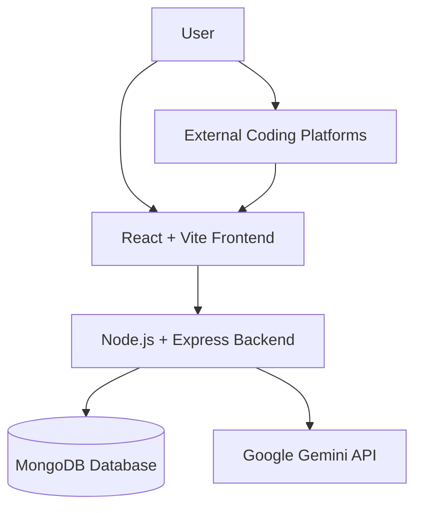

# Roundwise AI Interview Prep 🚀

**An AI-powered coding interview preparation platform with company-wise DSA questions, personalized study plans, progress tracking, revision scheduling, and AI-driven code analysis.**

[](https://github.com/Shivangiagarwal-sst/roundwise_ai_interview_prep)

**Prepare smarter. Practice consistently. Track your progress.**

---

## 🌐 Website Preview

[](https://roundwise-ai-interview-prep.onrender.com)

**Live Application:** [Open Roundwise AI Interview Prep](https://roundwise-ai-interview-prep.onrender.com)

**GitHub Repository:** [View Source Code](https://github.com/Shivangiagarwal-sst/roundwise_ai_interview_prep)

**Demo Video:** *Add your demo video link here.*

---

## 📌 Problem Statement

Preparing for coding interviews can be challenging because students often need to switch between company-wise question lists, coding platforms, study schedules, revision trackers, and code-analysis tools.

Students need a structured way to discover relevant interview questions, organize their preparation, identify weaknesses, and track their progress without managing everything separately.

Roundwise AI Interview Prep aims to bring these activities together in one platform.

## 🎯 Target Users

- Students preparing for software engineering interviews.
- Beginners learning Data Structures and Algorithms.
- Candidates preparing for company-specific coding rounds.
- Developers who want to organize coding practice and revision.
- Learners who want AI-assisted feedback on their solutions.

## 💡 Solution

Roundwise AI Interview Prep combines a company-wise coding question directory, personalized study planning, AI-powered code analysis, progress tracking, and a revision queue.

Users can discover questions, organize their preparation, practice problems on linked platforms, submit solutions for AI feedback, and revisit questions as part of their revision workflow.

## ✨ Key Features

### 1. 🏢 Company-Wise Question Directory

- Explore a directory of **659 companies**.
- View company-wise coding question counts.
- Search and filter companies.
- Sort the directory by supported criteria, such as name and recency.
- Discover coding problems relevant to technical interviews.

### 2. 📚 Coding Question Bank

- Browse coding interview questions associated with companies.
- Find relevant problems through available search and filtering options.
- Open linked coding problems on external platforms.
- Use the question bank to support structured interview preparation.

### 3. 📅 Personalized Study Plan Generator

- Generate a study plan based on your preparation requirements.
- Organize coding practice into a more structured workflow.
- Review the generated plan.
- Use planned questions to guide your preparation.

### 4. 🤖 AI-Powered Code Analysis

Submit a coding solution for AI-assisted feedback.

Depending on the solution and the AI response, the analysis can cover:

- Approach and logic explanation.
- Time and space complexity.
- Potential mistakes or logical issues.
- Edge cases.
- Suggestions for improvement.

AI-generated feedback is advisory. Always test your code and verify the analysis independently.

### 5. 📈 Progress Tracking

- Update the status of coding questions.
- Track your practice progress.
- Keep your preparation organized.
- Review completed and pending questions using the available tracking features.

### 6. 🔄 Revision Queue

- Identify questions due for review.
- View upcoming revisions.
- Revisit previously practiced problems.
- Maintain a consistent revision routine.

### 7. 🔐 Authentication and Demo Mode

- Register an account.
- Log in to access protected features.
- Use authenticated application workflows.
- Explore the available Demo Mode, if enabled in the deployment.

---

## 🛠️ Tech Stack

| Technology | Purpose |
|---|---|
| React | Building the user interface |
| Vite | Frontend development and production builds |
| CSS / configured styling tools | Styling and responsive layouts |
| Node.js | Backend JavaScript runtime |
| Express.js | REST API and backend routing |
| MongoDB | Persistent application data |
| Mongoose, if configured | MongoDB object modeling |
| Google Gemini API | AI-assisted code analysis |
| Git | Version control |
| GitHub | Source code hosting |
| Render | Backend or application hosting, as configured |

*The table describes the intended stack; retain only technologies used by the final implementation.*

---

## 🏗️ Application Architecture

Roundwise follows a client-server architecture.

1. **Frontend:** Provides the interface for company discovery, question browsing, study planning, code analysis, and progress tracking.
2. **Backend:** Handles API requests, application logic, authentication, database operations, and AI integration.
3. **MongoDB:** Stores persistent application data.
4. **Google Gemini API:** Supports AI-powered code analysis through the backend.
5. **External coding platforms:** Provide linked problems for hands-on practice.

### Architecture Diagram



### Project Structure

```text
roundwise_ai_interview_prep/
├── .github/
├── .gitignore
├── .nvmrc
├── LICENSE
├── client/
│   └── Frontend application
├── docs/
│   └── Project documentation
├── server/
│   ├── data/
│   │   └── companies/
│   ├── tests/
│   └── Backend application
├── package.json
├── package-lock.json
├── render.yaml
└── README.md
```

*This is a high-level overview. Refer to the repository for the complete source tree.*

---

## ⚙️ Local Setup

### Prerequisites

Install:

- Git
- Node.js version compatible with `.nvmrc`
- npm
- A MongoDB Atlas account or another configured MongoDB instance
- A Google Gemini API key for AI functionality

### 1. Clone the Repository

```bash
git clone https://github.com/Shivangiagarwal-sst/roundwise_ai_interview_prep.git
cd roundwise_ai_interview_prep
```

### 2. Install Dependencies

Install the root dependencies:

```bash
npm install
```

If the frontend and backend have independent dependency configurations, install those dependencies as required:

```bash
cd client
npm install
cd ../server
npm install
```

Follow the scripts and workspace configuration in the repository's `package.json` files.

### 3. Configure Environment Variables

Create local environment files using the variable names expected by the application.

**Backend — `server/.env`**

Example placeholders:

```env
PORT=5000
MONGODB_URI=your_mongodb_connection_string
JWT_SECRET=your_jwt_secret
GEMINI_API_KEY=your_gemini_api_key
CLIENT_URL=http://localhost:5173
NODE_ENV=development
```

**Frontend — `client/.env`**

Example placeholder:

```env
VITE_API_URL=http://localhost:5173
```

These values are examples, not guaranteed names or defaults. Check the actual backend configuration and frontend API service before using them. The frontend API URL may need to include the backend's local port and API prefix.

Never put real credentials in the README or commit real `.env` files.

### 4. Run the Application

Start the backend in one terminal using the script configured in `server/package.json`. For example:

```bash
cd server
npm run dev
```

Start the frontend in another terminal using the script configured in `client/package.json`. For example:

```bash
cd client
npm run dev
```

Open the local URL printed by the frontend development server.

*Use the actual scripts available in your repository if they differ from these examples.*

---

## 🔑 API and Database Configuration

### MongoDB

MongoDB is used for persistent application data. Configure the connection string through the backend environment variables.

The company question dataset is included under the server data directory in the repository structure. Its exact loading behavior depends on the implementation.

### Google Gemini API

The AI analysis feature uses the configured Gemini API integration through the backend.

To configure it:

1. Obtain an API key from Google AI Studio.
2. Store the key in the backend environment.
3. Use the variable name expected by the source code.
4. Restart the backend and test the analysis workflow.

AI functionality can be affected by invalid credentials, quota limits, rate limits, service outages, or model availability.

---

## 🧪 Testing

The repository contains a server test directory.

Run the test command configured in the relevant `package.json`. For example:

```bash
cd server
npm test
```

Build the frontend using its configured build script. For example:

```bash
cd client
npm run build
```

Verify the actual scripts before running these commands. Test results should be reported only after the commands have completed successfully.

Recommended manual verification:

- User registration and login.
- Company directory and question browsing.
- Search and filtering.
- Study plan generation.
- AI code analysis.
- Question status updates and progress tracking.
- Revision queue.
- Logout and protected-route behavior.

---

## 🚀 Deployment

The deployed application uses the hosting configuration available in the repository.

### Deployment Checklist

1. Push the complete source code to GitHub.
2. Configure the backend hosting service.
3. Configure the frontend hosting service, if deployed separately.
4. Set the required environment variables.
5. Connect the backend to MongoDB.
6. Configure the frontend to use the deployed backend URL.
7. Configure production CORS and authentication settings where required.
8. Test the deployed application's core workflows.

### Live Links

- **Application:** [Roundwise AI Interview Prep](https://roundwise-ai-interview-prep.onrender.com)
- **Repository:** [GitHub Source Code](https://github.com/Shivangiagarwal-sst/roundwise_ai_interview_prep)
- **Demo Video:** *Add your video link here.*

The live URL should be checked to confirm that it opens the frontend application and that the required workflows function correctly.

---

## 🔒 Security Considerations

- Keep environment files and API keys out of version control.
- Store Gemini and database credentials on the backend.
- Validate user input on the server.
- Protect private routes with the authentication mechanism implemented in the application.
- Handle database errors and AI service failures gracefully.
- Configure CORS for the intended production frontend.
- Never expose database credentials or private API secrets in frontend code.

---

## ⚠️ Limitations

- AI feedback may occasionally be inaccurate or incomplete.
- AI functionality depends on external API availability and usage limits.
- The accuracy and coverage of company-wise questions depend on the underlying dataset.
- Hosting free-tier limits may cause cold starts or slower initial requests.
- External coding platforms remain subject to their own availability and policies.

---

## 🔮 Future Improvements

Potential enhancements include:

- More adaptive study plans.
- Expanded question filters and recommendations.
- Improved revision scheduling.
- More detailed progress analytics.
- Additional code-quality and edge-case checks.
- Broader programming-language support.
- Expanded automated testing and monitoring.

---

## 👩‍💻 Author

**Shivangi Agarwal**

- GitHub: [Shivangiagarwal-sst](https://github.com/Shivangiagarwal-sst)
- Project Repository: [Roundwise AI Interview Prep](https://github.com/Shivangiagarwal-sst/roundwise_ai_interview_prep)

---

## 📄 License

See the [`LICENSE`](./LICENSE) file in this repository for licensing details.

---

**Roundwise AI Interview Prep — Prepare smarter, practice consistently, and improve one problem at a time.**
